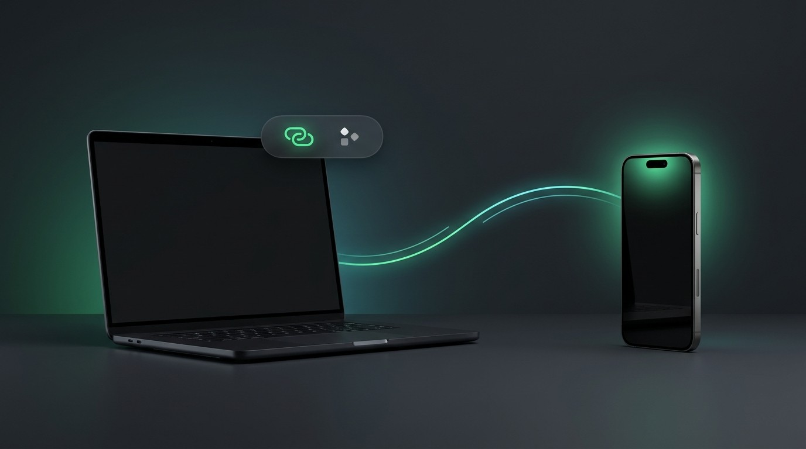
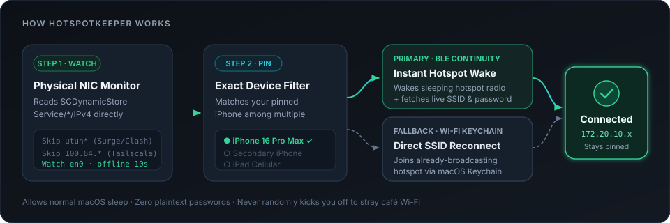
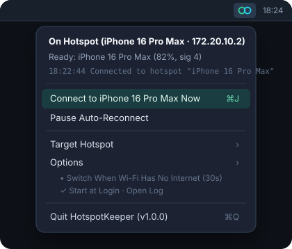

<p align="center">
  
</p>

<h1 align="center">HotspotKeeper</h1>

<p align="center">
  <strong>Keep your Mac reliably tethered to your pinned iPhone Personal Hotspot — even alongside Surge, Clash TUN, and Tailscale.</strong>
</p>

<p align="center">
  <a href="README.md"><strong>English</strong></a> · <a href="README.zh-CN.md">简体中文</a>
</p>

<p align="center">
  <a href="https://github.com/Wangnov/HotspotKeeper/actions/workflows/ci.yml"></a>
  <a href="https://github.com/Wangnov/HotspotKeeper/releases/latest"></a>
  
  <a href="LICENSE"></a>
</p>

<p align="center">
  
</p>

---

## Why HotspotKeeper?

macOS shows your iPhone under **Personal Hotspot** in the Wi-Fi menu, yet rarely reconnects to it reliably on its own when Wi-Fi drops — especially while working remotely from a backpack, café, or commute.

Existing hotspot scripts and utilities also break in two very common power-user setups:

1. **VPN / TUN proxy tools (`Surge Enhanced Mode`, `Clash / Mihomo TUN`, `Tailscale`)**: tools that read `State:/Network/Global/IPv4` see `PrimaryInterface = utun*` (`198.18.0.1`) instead of `en0`, mistakenly thinking your Mac is offline 100% of the time — or failing to detect that you are already on the hotspot (`172.20.10.x`).
2. **Multiple Apple devices on the same Apple Account**: tools that blindly wake the first Bluetooth device discovered will randomly trigger your secondary iPhone or cellular iPad instead of your main hotspot phone.

**HotspotKeeper** is a zero-dependency, single-file native macOS menu bar app + CLI (~10 MB RAM) built to solve both cleanly.

---

## Key Features

- **Surge / Clash TUN / Tailscale Safe** — Inspects real physical network services directly from `SCDynamicStore` (`State:/Network/Service/.*/IPv4`), automatically ignoring `utun*`, `198.18.*`, `100.64.*`, and link-local addresses.
- **Pin Your Exact iPhone** — Filter nearby same-Apple-Account devices by name (case- and whitespace-insensitive) from the menu bar, CLI, or custom input dialog — never accidentally wake the wrong phone.
- **Dual-Channel Reconnect** — Uses Apple's Instant Hotspot BLE wake (`SFRemoteHotspotSession`) first to wake sleeping hotspot radios and obtain live credentials; automatically falls back to direct macOS Keychain Wi-Fi join if the SSID is already broadcasting.
- **Remote-Desktop Friendly (Sill / SSH / AI Agents)** — Never aggressively kicks you off your hotspot back to random weak café/public Wi-Fi networks. Optional *Switch When Wi-Fi Has No Internet (30s)* toggle handles dead or captive-portal Wi-Fi.
- **Sleep & Battery Respectful** — Uses `NSActivityUserInitiatedAllowingIdleSystemSleep`, coexisting cleanly with macOS sleep policies and **Amphetamine**.
- **Bilingual Native UI** — Automatically adapts to Simplified Chinese and English based on macOS system language. Zero third-party dependencies, zero plaintext passwords stored or logged.

---

## Architecture

<p align="center">
  
</p>

---

## Menu Bar Preview

<p align="center">
  
</p>

---

## Quick Start

### Option 1: One-Line Install (Downloads Universal Binary + Enables Start at Login)

```bash
curl -fsSL https://raw.githubusercontent.com/Wangnov/HotspotKeeper/main/install.sh | bash
```

### Option 2: Build from Source (Requires Xcode Command Line Tools)

```bash
git clone https://github.com/Wangnov/HotspotKeeper.git
cd HotspotKeeper
chmod +x build.sh
./build.sh
~/.local/bin/hotspot-keeper --install-login
```

> Pass `./build.sh --universal` to compile a universal (`arm64` + `x86_64`) binary.

### Requirements

- macOS 14.0+ (Apple Silicon or Intel)
- For Bluetooth Instant Hotspot wake: iPhone and Mac signed in to the same Apple Account with Bluetooth & Personal Hotspot enabled.
- Even without Instant Hotspot (e.g. different Apple Account), direct Wi-Fi Keychain reconnect still works whenever your hotspot SSID is broadcasting.

---

## CLI Usage

```bash
hotspot-keeper --status               # Show physical link, IP, router, hotspot & internet status
hotspot-keeper --list                 # Discover nearby same-Apple-Account Instant Hotspot devices
hotspot-keeper --test                 # Wake target iPhone hotspot over BLE without switching Wi-Fi
hotspot-keeper --force                # Immediately connect to target hotspot (dual-channel)
hotspot-keeper --target "My iPhone"   # Override target device name for one run
hotspot-keeper --headless             # Run daemon without a menu bar icon
hotspot-keeper --install-login        # Install & start LaunchAgent
hotspot-keeper --uninstall-login      # Remove LaunchAgent
```

Example output:

```text
$ hotspot-keeper --status
target=iPhone 16 Pro Max wifiOn=1 hasPhysicalLink=1 iface=en0 ip=192.168.1.42 router=192.168.1.1 onHotspot=0 internet=1 paused=0 deadWifi=0 loginItem=1

$ hotspot-keeper --list
Found 2 Instant Hotspot device(s):
  * iPhone 16 Pro Max (82%, sig 4)
  - iPhone Duo (74%, sig 3)
```

---

## Logs & Uninstall

- **Log file**: `~/Library/Logs/HotspotKeeper.log` (auto-trimmed at 2 MB; passwords are never logged)
- **Uninstall**:
  ```bash
  hotspot-keeper --uninstall-login
  rm -rf ~/Applications/HotspotKeeper.app ~/.local/bin/hotspot-keeper ~/Library/Logs/HotspotKeeper.log
  ```

---

## Acknowledgments & License

Inspired by [samihalawa/mac-auto-hotspot](https://github.com/samihalawa/mac-auto-hotspot) and built from scratch to support TUN proxies (Surge / Clash / Tailscale), exact multi-iPhone pinning, dual-channel reconnect, and bilingual UI.

Released under the [MIT License](LICENSE).
