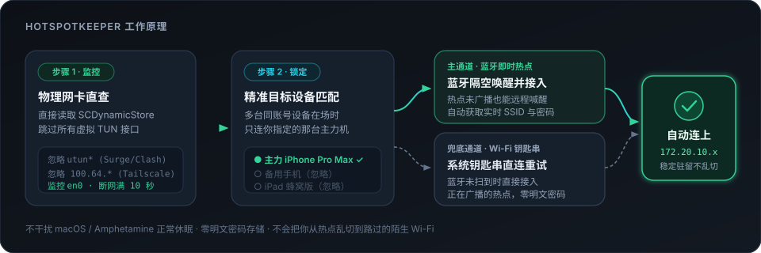

<p align="center">
  
</p>

<h1 align="center">HotspotKeeper</h1>

<p align="center">
  <strong>断网自动唤醒并精准连接指定 iPhone 个人热点的轻量 macOS 工具 —— 完美兼容 Surge 增强模式、Clash TUN 与 Tailscale。</strong>
</p>

<p align="center">
  <a href="README.md">English</a> · <a href="README.zh-CN.md"><strong>简体中文</strong></a>
</p>

<p align="center">
  <a href="https://github.com/Wangnov/HotspotKeeper/actions/workflows/ci.yml"></a>
  <a href="https://github.com/Wangnov/HotspotKeeper/releases/latest"></a>
  
  <a href="LICENSE"></a>
</p>

<p align="center">
  
</p>

---

## 为什么做 HotspotKeeper？

macOS 菜单栏虽然列出了 iPhone 的「个人热点」，但一旦断网，系统极少主动把热点连回来——尤其是外出把 MacBook 放包里用 [Sill](https://github.com/Saffsanity/sill) / SSH / AI Agent 远程干活时，热点一断就彻底失联。

而现有的自动热点工具或脚本，在两类高频场景下几乎都会踩坑：

1. **开启了 Surge 增强模式 / Clash TUN / Tailscale**：只读 `State:/Network/Global/IPv4` 的工具看到的 `PrimaryInterface` 是 `utun*`（网关 `198.18.0.1`），会**永久误判电脑断网**，也认不出当前其实已经连上了热点（`172.20.10.x`）。
2. **同一 Apple ID 下有多台 iPhone / iPad**：默认只唤醒蓝牙列表第一台设备的工具，经常误连备用机或 iPad，而不是你的主力流量卡手机。

**HotspotKeeper** 是一个单文件、零第三方依赖的原生 macOS 菜单栏应用 + 命令行工具（常驻内存约 10 MB），专门解决以上痛点。

---

## 核心特性

- **100% 穿透 Surge / Clash TUN / Tailscale**：直接读取 `SCDynamicStore` 下的真实物理网卡服务（`State:/Network/Service/.*/IPv4`），自动排除 `utun*`、`198.18.*`、`100.64.*` 与 `169.254.*`，准确判断真断网与热点状态。
- **精准锁定目标 iPhone**：多台同账号设备同时在场时，严格按你锁定的设备名唤醒和接入（自动忽略大小写与空格差异），菜单栏可直接勾选发现的设备或手动输入自定义名称。
- **双通道自动重连 + 主动蓝牙刷新**：
  - **主通道（蓝牙即时热点）**：调用系统 `SFRemoteHotspotSession` 隔空唤醒处于休眠状态的 iPhone 热点，支持断网时主动刷新蓝牙会话与纯内存凭证缓存（最多重试 3 次）；
  - **兜底通道（Wi-Fi 钥匙串直连）**：蓝牙暂未扫到或不同 Apple ID 时，直接走内存缓存或系统钥匙串接入正在广播的同名热点。
- **专为远程办公 / Sill 场景调优**：
  - 连上热点后**绝不乱切回**路过的弱信号/公用 Wi-Fi；
  - 菜单栏「选项」支持开启 **“Wi-Fi 无外网（30 秒）自动切热点”**，轻松应对酒店/咖啡馆认证页或死 Wi-Fi。
- **可选内置「合盖防休眠」引擎（v1.2.0，仅 MacBook，默认关闭）**：专为放包远程办公设计，可选替代 Amphetamine + Power Protect。联网期间保持合盖不休眠，断网自动进入 **120 秒 / 至少 3 轮重连宽限期**（清空退避、强制刷新蓝牙），彻底连不上、低电量（<20%）、过热（`Serious`）或达到电池连续合盖上限（默认 4 小时）时自动释放并安全休眠。
- **默认零侵入、不干扰系统休眠**：未开启合盖防休眠时**完全不需要 `sudo`、不碰 `pmset`**，使用 `NSActivityUserInitiatedAllowingIdleSystemSleep`，与 macOS 原生策略和 **Amphetamine** 和平共处。
- **中英双语自适应 + 零明文密码**：随 macOS 系统语言自动切换简体中文 / 英文界面；密码绝不落盘、绝不打印进日志。

---

## 工作原理

<p align="center">
  
</p>

---

## 菜单栏预览

<p align="center">
  
</p>

---

## 快速安装

### 方式一：一键安装（自动下载通用安装包并开启登录自启）

```bash
curl -fsSL https://raw.githubusercontent.com/Wangnov/HotspotKeeper/main/install.sh | bash
```

### 方式二：源码编译（仅需系统自带 `clang` / Command Line Tools）

```bash
git clone https://github.com/Wangnov/HotspotKeeper.git
cd HotspotKeeper
chmod +x build.sh
./build.sh
~/.local/bin/hotspot-keeper --install-login
```

> 使用 `./build.sh --universal` 可构建 Apple Silicon + Intel 通用二进制（Universal Binary）。

### 使用条件

- macOS 14.0 及以上（Apple Silicon / Intel 均支持）
- 使用蓝牙隔空唤醒功能需 Mac 与 iPhone 登录同一 Apple ID、开启蓝牙与个人热点；若不同账号，只要手机热点保持广播，兜底的 Wi-Fi 钥匙串直连通道依然可用。

---

## 命令行用法

```bash
hotspot-keeper --status               # 查看物理网卡、IP、网关、热点、合盖、电量、温控与电源状态
hotspot-keeper --list                 # 扫描附近支持即时热点的同账号 iPhone（含电量与信号）
hotspot-keeper --test                 # 仅测试蓝牙唤醒目标 iPhone 热点（不切换当前 Wi-Fi）
hotspot-keeper --force                # 立即双通道连接目标热点
hotspot-keeper --target "设备名"      # 单次覆盖目标热点名称
hotspot-keeper --headless             # 纯后台运行（不显示菜单栏图标）
hotspot-keeper --setup-clamshell      # [可选，需 sudo] 安装合盖防休眠三重安全组件
hotspot-keeper --enable-clamshell     # 开启合盖防休眠模式（需先执行 --setup-clamshell）
hotspot-keeper --disable-clamshell    # 关闭合盖防休眠并释放 SleepDisabled=0
hotspot-keeper --sleep-now            # 释放 SleepDisabled=0 并立即让 Mac 休眠
hotspot-keeper --teardown-clamshell   # [需 sudo] 恢复 SleepDisabled=0 并彻底移除合盖防休眠系统组件
hotspot-keeper --install-login        # 安装并启动开机自启 LaunchAgent
hotspot-keeper --uninstall-login      # 移除开机自启服务（若持有电源锁会先释放）
```

示例输出：

```text
$ hotspot-keeper --status
target=iPhone 16 Pro Max wifiOn=1 hasPhysicalLink=1 iface=en0 ip=192.168.1.42 router=192.168.1.1 onHotspot=0 internet=1 paused=0 deadWifi=0 loginItem=1 clamshellOptIn=0 clamshellReady=0 amphetamine=0 lid=open sleepDisabled=0 batt=86%(BATT) thermal=nominal

$ hotspot-keeper --list
发现 2 台支持即时热点的同账号设备：
  * iPhone 16 Pro Max（电量 82%，信号 4）
  - iPhone Duo（电量 74%，信号 3）
```

---

## 可选功能：内置合盖防休眠模式（v1.2.0 · 仅限 MacBook）

> **默认完全关闭（Opt-in）。** 如果你只需要断网自动连热点，或者希望继续配合 Amphetamine 使用，完全不需要安装此模块——HotspotKeeper 默认不会索要 `sudo`，也不会修改任何 `pmset` 系统设置。

如果你习惯外出把 MacBook 合盖放包里，用手机通过 **Sill** / SSH / AI Agent 远程干活，Apple Silicon 上阻止合盖休眠需要 `pmset -a disablesleep 1`。v1.2.0 内置了与重连状态机深度联动的合盖保活引擎，彻底摆脱对 Amphetamine + Power Protect 的外部依赖，同时避免“刚断网就被 Amphetamine 提前放睡导致没机会重连”的痛点：

### 多重安全保护机制（三重防锁死 + 放包防闷烧）

| 保护层 | 策略说明 |
| :--- | :--- |
| **断网重连宽限期** | 联网保活期间若突然断网，保持合盖唤醒 **至少 120 秒且至少完成 3 轮完整重连**（硬上限 **180 秒**，宽限期内清空退避并强制刷新蓝牙扫描）。若依然失联，立即释放 `disablesleep 0` 并在合盖 10 秒未睡时补发 `pmset sleepnow`。 |
| **有链路无外网上限** | 连着死 Wi-Fi / 认证页且连续 **4 分钟**无外网时，主动释放休眠，防止包里耗干电量。 |
| **DarkWake 防重锁** | 合盖状态下因断网/低电/过热释放后进入锁存态（`ReleasedLatched`），Power Nap / DarkWake 暗唤醒绝不会偷偷重新开启 `disablesleep 1`，直到真正**开盖**或完整系统唤醒才恢复监控。 |
| **温控、电量与时长兜底** | 温控达到 `Serious` 立即释放并 `pmset sleepnow`；电池 **< 20%** 释放休眠（需充回 **≥ 25%** 或插电才恢复，防抖迟滞）；纯电池连续合盖保活上限默认 **4 小时**（菜单栏可调 2h / 4h / 6h / 不限）。 |
| **三重防持久化锁死** | 1. 正常退出 / `SIGTERM` / `SIGINT` / 系统关机前自动恢复 `disablesleep 0`。<br>2. 独立纯 `/bin/sh` 租约看门狗 LaunchAgent（每 30 秒巡检），App 崩溃、`kill -9` 甚至**直接把 App 拖进废纸篓**超过 120 秒都会自动复位。<br>3. Root 级 `RunAtLoad` 开机复位 LaunchDaemon（`/Library/LaunchDaemons/io.github.wangnov.hotspot-keeper.sleepguard.plist`），每次开机在登录/FileVault 解锁前即恢复 `disablesleep 0`。 |
| **Amphetamine 冲突避让** | 检测到 **Amphetamine**（`com.if.Amphetamine`）正在运行或外部工具已持有 `SleepDisabled=1` 时自动避让，绝不互相打架。 |

### 一键配置与从 Amphetamine 平滑切换

```bash
# 1. 安装最小权限（仅限当前用户）sudoers（visudo 校验、0440）+ 开机复位守护 + 独立租约看门狗
hotspot-keeper --setup-clamshell

# 2. 若之前使用 Amphetamine，请在【开盖状态】下退出 Amphetamine（并关闭其开机自启）
# 3. 开启合盖防休眠（或直接在菜单栏勾选）
hotspot-keeper --enable-clamshell
```

> [!WARNING]
> - **生效期间系统菜单「睡眠」和短按电源键会被 macOS 屏蔽**（长按电源键强制关机仍有效）。需要主动合盖睡眠时，请使用 HotspotKeeper 菜单栏里的 **「立即睡眠 (`⌘S`)」** 或执行 `hotspot-keeper --sleep-now`。
> - **放包散热提示**：MacBook 合盖放进密闭内胆包会大幅降低被动散热能力，强烈建议同时开启电池低电量模式（`sudo pmset -b lowpowermode 1`），并避免在密闭包内跑重度 CPU/GPU 编译或训练任务。
> - **完整卸载**：若曾执行过 `--setup-clamshell`，卸载前请务必先执行 `hotspot-keeper --teardown-clamshell`，确保 `SleepDisabled` 恢复为 `0` 并清理所有系统组件。

---

## 日志与卸载

- **运行日志**：`~/Library/Logs/HotspotKeeper.log`（超过 2 MB 自动截断，绝不记录密码）
- **完全卸载**：
  ```bash
  hotspot-keeper --teardown-clamshell   # 仅在曾执行过 --setup-clamshell 时需要
  hotspot-keeper --uninstall-login
  rm -rf ~/Applications/HotspotKeeper.app ~/.local/bin/hotspot-keeper \
         ~/Library/Logs/HotspotKeeper.log ~/Library/Application\ Support/HotspotKeeper
  ```

---

## 致谢与协议

思路受 [samihalawa/mac-auto-hotspot](https://github.com/samihalawa/mac-auto-hotspot) 启发，针对 TUN 代理兼容（Surge / Clash / Tailscale）、多设备精准锁定、双通道重连与中英双语体验进行了全面重写。

基于 [MIT License](LICENSE) 开源。
