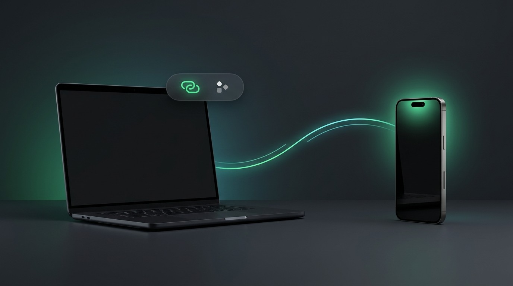
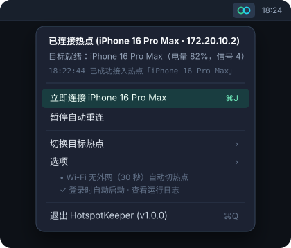

<p align="center">
  
</p>

<h1 align="center">HotspotKeeper</h1>

<p align="center">
  <strong>断网自动唤醒并精准连接指定 iPhone 个人热点的轻量 macOS 工具 —— 完美兼容 Surge 增强模式、Clash TUN 与 Tailscale。</strong>
</p>

<p align="center">
  <a href="README.md">English</a> · <a href="README.zh-CN.md"><strong>简体中文</strong></a>
</p>

<p align="center">
  <a href="https://github.com/Wangnov/HotspotKeeper/actions/workflows/ci.yml"></a>
  <a href="https://github.com/Wangnov/HotspotKeeper/releases/latest"></a>
  
  <a href="LICENSE"></a>
</p>

<p align="center">
  
</p>

---

## 为什么做 HotspotKeeper？

macOS 菜单栏虽然列出了 iPhone 的「个人热点」，但一旦断网，系统极少主动把热点连回来——尤其是外出把 MacBook 放包里用 [Sill](https://github.com/Saffsanity/sill) / SSH / AI Agent 远程干活时，热点一断就彻底失联。

而现有的自动热点工具或脚本，在两类高频场景下几乎都会踩坑：

1. **开启了 Surge 增强模式 / Clash TUN / Tailscale**：只读 `State:/Network/Global/IPv4` 的工具看到的 `PrimaryInterface` 是 `utun*`（网关 `198.18.0.1`），会**永久误判电脑断网**，也认不出当前其实已经连上了热点（`172.20.10.x`）。
2. **同一 Apple ID 下有多台 iPhone / iPad**：默认只唤醒蓝牙列表第一台设备的工具，经常误连备用机或 iPad，而不是你的主力流量卡手机。

**HotspotKeeper** 是一个单文件、零第三方依赖的原生 macOS 菜单栏应用 + 命令行工具（常驻内存约 10 MB），专门解决以上痛点。

---

## 核心特性

- **100% 穿透 Surge / Clash TUN / Tailscale**：直接读取 `SCDynamicStore` 下的真实物理网卡服务（`State:/Network/Service/.*/IPv4`），自动排除 `utun*`、`198.18.*`、`100.64.*` 与 `169.254.*`，准确判断真断网与热点状态。
- **精准锁定目标 iPhone**：多台同账号设备同时在场时，严格按你锁定的设备名唤醒和接入（自动忽略大小写与空格差异），菜单栏可直接勾选发现的设备或手动输入自定义名称。
- **双通道自动重连**：
  - **主通道（蓝牙即时热点）**：调用系统 `SFRemoteHotspotSession` 隔空唤醒处于休眠状态的 iPhone 热点，自动拿到实时 SSID 与密码接入（最多重试 3 次）；
  - **兜底通道（Wi-Fi 钥匙串直连）**：蓝牙暂未扫到或不同 Apple ID 时，直接走系统钥匙串尝试接入正在广播的同名热点。
- **专为远程办公 / Sill 场景调优**：
  - 连上热点后**绝不乱切回**路过的弱信号/公用 Wi-Fi；
  - 菜单栏「选项」支持开启 **“Wi-Fi 无外网（30 秒）自动切热点”**，轻松应对酒店/咖啡馆认证页或死 Wi-Fi。
- **不干扰系统休眠**：使用 `NSActivityUserInitiatedAllowingIdleSystemSleep`，和 **Amphetamine** 的放包防闷烧策略和平共处。
- **中英双语自适应 + 零明文密码**：随 macOS 系统语言自动切换简体中文 / 英文界面；日志中绝不打印任何 Wi-Fi 密码。

---

## 工作原理

<p align="center">
  
</p>

---

## 菜单栏预览

<p align="center">
  
</p>

---

## 快速安装

### 方式一：一键安装（自动下载通用安装包并开启登录自启）

```bash
curl -fsSL https://raw.githubusercontent.com/Wangnov/HotspotKeeper/main/install.sh | bash
```

### 方式二：源码编译（仅需系统自带 `clang` / Command Line Tools）

```bash
git clone https://github.com/Wangnov/HotspotKeeper.git
cd HotspotKeeper
chmod +x build.sh
./build.sh
~/.local/bin/hotspot-keeper --install-login
```

> 使用 `./build.sh --universal` 可构建 Apple Silicon + Intel 通用二进制（Universal Binary）。

### 使用条件

- macOS 14.0 及以上（Apple Silicon / Intel 均支持）
- 使用蓝牙隔空唤醒功能需 Mac 与 iPhone 登录同一 Apple ID、开启蓝牙与个人热点；若不同账号，只要手机热点保持广播，兜底的 Wi-Fi 钥匙串直连通道依然可用。

---

## 命令行用法

```bash
hotspot-keeper --status               # 查看当前物理网卡、IP、网关、热点与外网状态
hotspot-keeper --list                 # 扫描附近支持即时热点的同账号 iPhone（含电量与信号）
hotspot-keeper --test                 # 仅测试蓝牙唤醒目标 iPhone 热点（不切换当前 Wi-Fi）
hotspot-keeper --force                # 立即双通道连接目标热点
hotspot-keeper --target "设备名"      # 单次覆盖目标热点名称
hotspot-keeper --headless             # 纯后台运行（不显示菜单栏图标）
hotspot-keeper --install-login        # 安装并启动开机自启 LaunchAgent
hotspot-keeper --uninstall-login      # 移除开机自启服务
```

示例输出：

```text
$ hotspot-keeper --status
target=iPhone 16 Pro Max wifiOn=1 hasPhysicalLink=1 iface=en0 ip=192.168.1.42 router=192.168.1.1 onHotspot=0 internet=1 paused=0 deadWifi=0 loginItem=1

$ hotspot-keeper --list
发现 2 台支持即时热点的同账号设备：
  * iPhone 16 Pro Max（电量 82%，信号 4）
  - iPhone Duo（电量 74%，信号 3）
```

---

## 进阶组合：MacBook 放包里远程干活

如果你习惯外出把 MacBook 合盖放包里，用手机通过 **Sill** 或 SSH 控制电脑：
1. 安装 **Amphetamine** + **Power Protect**，开启低电量（20%）自动停止防休眠，平时保持正常休眠防闷烧；
2. 电池模式开启 **低电量模式**（`sudo pmset -b lowpowermode 1`）压住发热与功耗；
3. 配合 **HotspotKeeper**，在 MacBook 保持唤醒期间即使热点闪断也能在 10 秒内自动唤醒并重连。

---

## 日志与卸载

- **运行日志**：`~/Library/Logs/HotspotKeeper.log`（超过 2 MB 自动截断，绝不记录密码）
- **完全卸载**：
  ```bash
  hotspot-keeper --uninstall-login
  rm -rf ~/Applications/HotspotKeeper.app ~/.local/bin/hotspot-keeper ~/Library/Logs/HotspotKeeper.log
  ```

---

## 致谢与协议

思路受 [samihalawa/mac-auto-hotspot](https://github.com/samihalawa/mac-auto-hotspot) 启发，针对 TUN 代理兼容（Surge / Clash / Tailscale）、多设备精准锁定、双通道重连与中英双语体验进行了全面重写。

基于 [MIT License](LICENSE) 开源。
